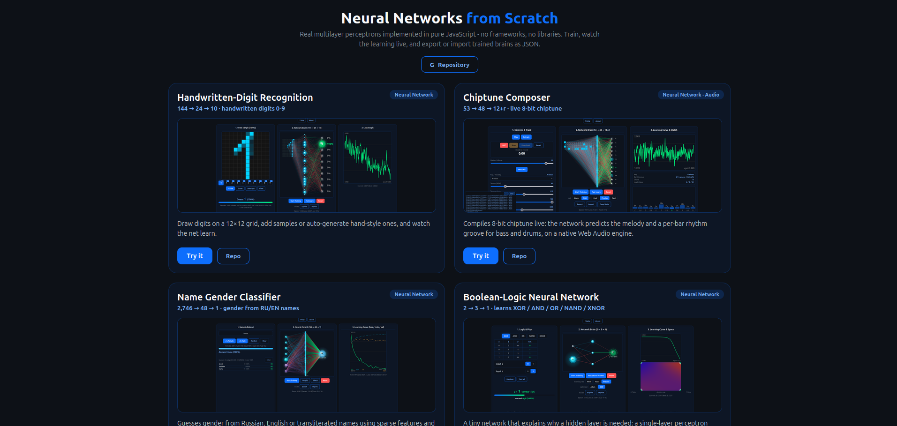
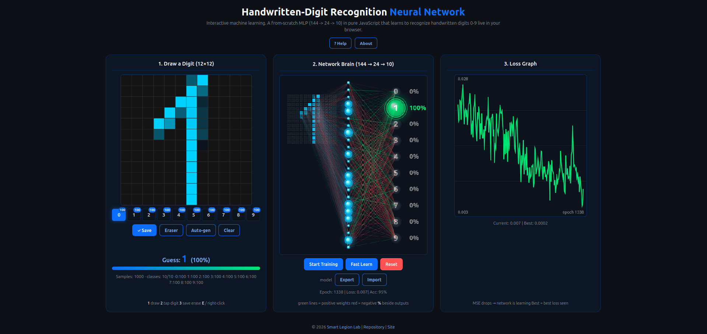
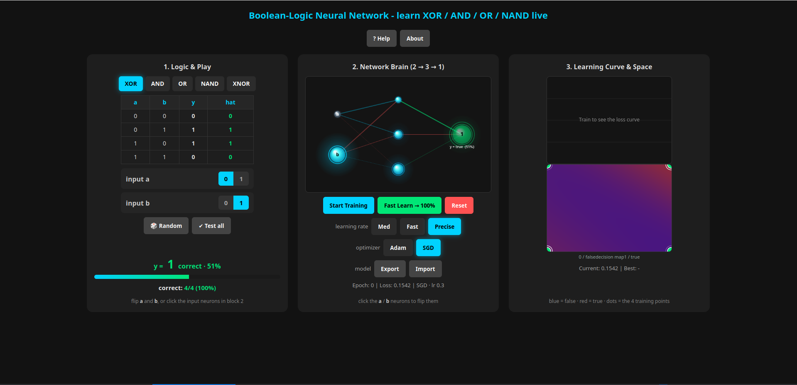
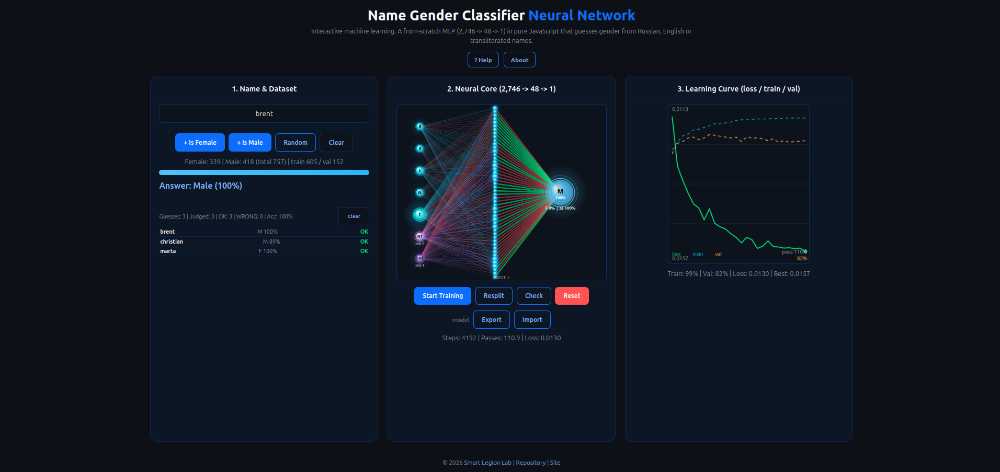
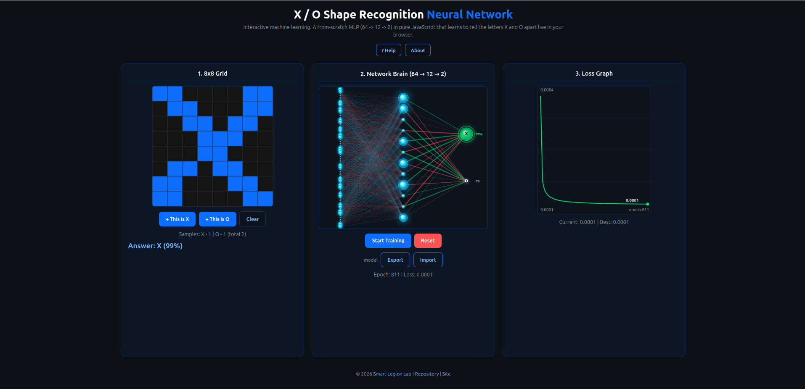
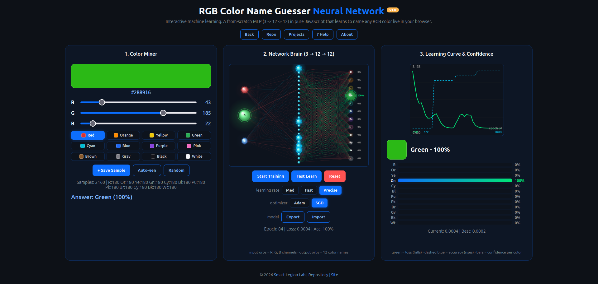
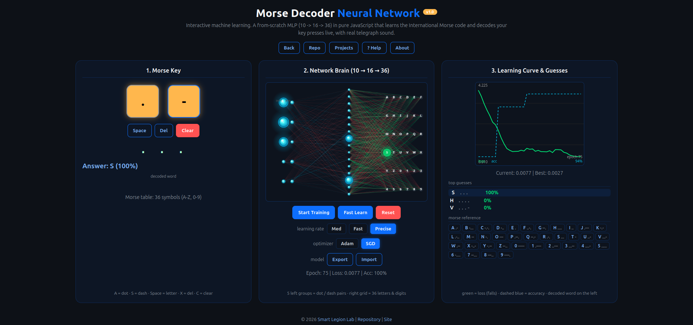
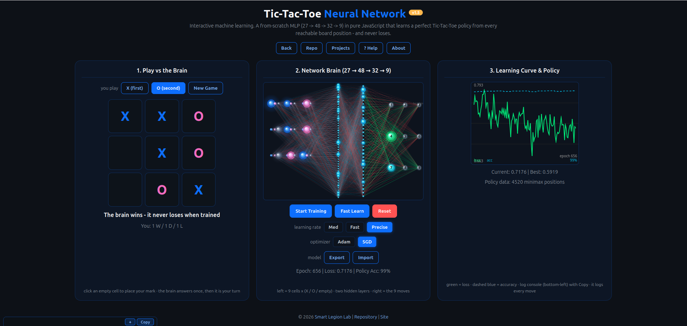
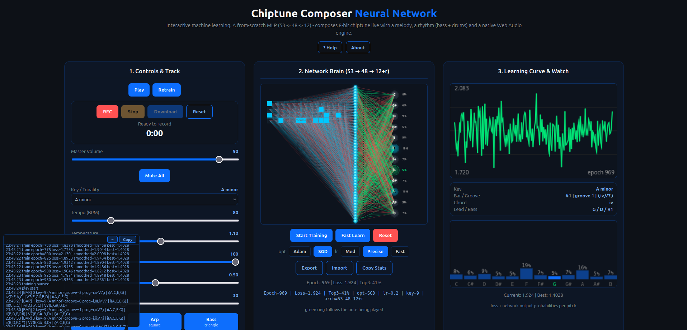

# from-scratch-neural-networks

[](https://github.com/smartlegionlab/from-scratch-neural-networks/releases)

[](https://github.com/smartlegionlab/from-scratch-neural-networks/blob/master/LICENSE)
[](https://github.com/smartlegionlab/from-scratch-neural-networks/stargazers)
[](https://github.com/smartlegionlab/from-scratch-neural-networks/network/members)


A collection of real multilayer perceptrons (MLPs) implemented **from scratch in pure JavaScript**. No frameworks, no external libraries, no runtime dependencies. Each app trains and runs a neural network entirely in the browser, with live visualization of the learning process.

---

## Overview

This repository contains **eight** independent, ready-to-run applications. Each one implements a complete training pipeline by hand: the forward pass, error backpropagation, and weight updates with gradient descent. Everything runs client-side, so no build step is required.

The apps are designed as an educational demonstration: they show, in real time, how a small network reorganizes its weights to solve a specific problem. All values rendered on screen correspond to the actual state of the network.

The entry point for all applications is the `index.html` gallery page.

---

## Feature summary

- **Networks trained from scratch** in plain JavaScript (sigmoid activation, backpropagation, mini-batch SGD; the Boolean, Chiptune, RGB Color, Morse and Tic-Tac-Toe apps also offer Adam as an optimizer).
- **Interactive input** - draw, type, flip values, press a telegraph key, play a board game, and watch predictions update live.
- **Live visualization** - neurons are rendered as pulsing orbs whose brightness reflects activation; synapse lines show the sign and relative magnitude of weights; loss graphs and decision maps reflect the real training dynamics.
- **Policy learning** - the Tic-Tac-Toe app learns a perfect policy from every reachable position labeled by a minimax teacher and never loses.
- **Multi-head output** - the Chiptune app predicts both the next pitch class and a per-bar rhythm groove.
- **Audio** - a native Web Audio API engine (no samples) for chiptune with WAV recording, and realistic synthesized telegraph key sounds (dit, dah, key click) for the Morse app.
- **Auto-stop at 100%** - the Boolean, RGB Color, Morse and Tic-Tac-Toe apps freeze the weights the moment training reaches the target, so the result stays stable.
- **Model persistence** - every app can export its trained weights to a JSON file and import them back, so trained models can be saved, shared, or reused without retraining.
- **Responsive layout** - the interfaces adapt for desktop, tablet, and mobile, including touch input.
- **Built-in Help and About dialogs** in every application.

---

## Applications

| # | File (repo)                                                                              | Live demo                                                                                         | App                                          | Network        | Learns                       |
|---|------------------------------------------------------------------------------------------|---------------------------------------------------------------------------------------------------|----------------------------------------------|----------------|------------------------------|
| 1 | [logic-gates-neural-network.html](logic-gates-neural-network.html)                       | [try it](https://smartlegionlab.github.io/interactive/logic-gates-neural-network.html)            | Boolean-Logic Neural Network                 | 2 → 3 → 1      | XOR / AND / OR / NAND / XNOR |
| 2 | [digit-recognition-neural-network.html](digit-recognition-neural-network.html)           | [try it](https://smartlegionlab.github.io/interactive/digit-recognition-neural-network.html)      | Handwritten-Digit Recognition Neural Network | 144 → 24 → 10  | Handwritten digits 0-9       |
| 3 | [x-o-recognition-neural-network.html](x-o-recognition-neural-network.html)               | [try it](https://smartlegionlab.github.io/interactive/x-o-recognition-neural-network.html)        | X / O Shape Recognition Neural Network       | 64 → 12 → 2    | The letters X and O          |
| 4 | [name-gender-classifier-neural-network.html](name-gender-classifier-neural-network.html) | [try it](https://smartlegionlab.github.io/interactive/name-gender-classifier-neural-network.html) | Name Gender Classifier Neural Network        | 2,746 → 48 → 1 | Gender from RU/EN names      |
| 5 | [chiptune-composer-neural-network.html](chiptune-composer-neural-network.html)           | [try it](https://smartlegionlab.github.io/interactive/chiptune-composer-neural-network.html)      | Chiptune Composer Neural Network             | 53 → 48 → 12+r | Compose 8-bit chiptune live  |
| 6 | [rgb-color-name-guesser-neural-network.html](rgb-color-name-guesser-neural-network.html) | [try it](https://smartlegionlab.github.io/interactive/rgb-color-name-guesser-neural-network.html) | RGB Color Name Guesser Neural Network        | 3 → 24 → 12    | Names any RGB color          |
| 7 | [morse-decoder-neural-network.html](morse-decoder-neural-network.html)                   | [try it](https://smartlegionlab.github.io/interactive/morse-decoder-neural-network.html)          | Morse Decoder Neural Network                 | 10 → 16 → 36   | Morse code A-Z and 0-9       |
| 8 | [tic-tac-toe-brain-neural-network.html](tic-tac-toe-brain-neural-network.html)           | [try it](https://smartlegionlab.github.io/interactive/tic-tac-toe-brain-neural-network.html)      | Tic-Tac-Toe Brain Neural Network             | 27 → 24 → 9    | Perfect Tic-Tac-Toe play     |

---

## Screenshots











---

## Getting started

### Run with a local server

The applications are **no longer single-file**. Each app is split into an HTML file, a stylesheet (`css/`) and a script (`js/`), and the gallery page `index.html` loads screenshots from `data/images/`. Because of this, **opening the HTML files directly by double-click will not work** - you must serve the folder over HTTP:

```bash
python -m http.server 8000
```

then open [http://localhost:8000](http://localhost:8000) and pick `index.html` (or one of the application pages). Any static server works, for example `npx serve`, or a GitHub Pages deployment. No build step, no package manager, and no internet connection is required - everything runs 100% client-side once served.

The published demos for this project live under the `interactive/` path, with an index of all demonstrations at [interactive/index.html](https://smartlegionlab.github.io/interactive/index.html).

---

## Applications in detail

### 1. Boolean-Logic Neural Network - `logic-gates-neural-network.html`

A small **2 → 3 → 1** network that learns classic logic gates. It is a good introduction to why a hidden layer is necessary: a single-layer perceptron cannot learn XOR, because its two "true" inputs sit diagonally and cannot be separated by a straight line.

**How to use:**
1. Choose a logic function: **XOR, AND, OR, NAND or XNOR**. Switching a function resets the network, so each gate trains from zero.
2. Flip the **a** and **b** inputs (switches, or by clicking the input neurons in the network view).
3. Press **Start Training** or **Fast Learn → 100%**. Training stops automatically once all 4 of 4 cases are correct.
4. Adjust the **learning rate** and choose the **optimizer** (**SGD + momentum** by default, or **Adam**).
5. Use **Export / Import** to save or load the trained brain as a JSON file.

The right-hand panel shows a **decision map**: every pixel of the input space is fed through the network and colored by its output.

### 2. Handwritten-Digit Recognition Neural Network - `digit-recognition-neural-network.html`

A **144 → 24 → 10** network (12×12 grayscale input grid → 24 hidden neurons → 10 outputs) that recognizes the digits 0–9. Training uses mini-batch SGD with momentum and exact MSE backpropagation.

**How to use:**
1. Draw a digit **0–9** on the grid with the mouse, finger, or stylus.
2. Tap the matching digit, press **✓ Save** to add the sample.
3. Use the **Eraser** button, the **E** key, or the **right mouse button**.
4. Press **Auto-gen** for 250 hand-styled samples, then **Start Training** or **Fast Learn**.
5. The **Acc** figure shows dataset accuracy live.

### 3. X / O Shape Recognition Neural Network - `x-o-recognition-neural-network.html`

A minimal **64 → 12 → 2** dense network that learns to distinguish the letters **X** and **O** drawn on an 8×8 grid.

**How to use:**
1. Draw **X** and press **+ This is X**; draw **O** and press **+ This is O**.
2. Repeat **3–5 times per letter**, varying size and position.
3. Press **Start Training** and draw a new X or O any time - the network replies instantly with a confidence percentage.

### 4. Name Gender Classifier Neural Network - `name-gender-classifier-neural-network.html`

A **2,746 → 48 → 1** network that guesses gender from names written in **Russian, English, or transliteration**, using sparse features over a normalized 27-letter alphabet.

**How to use:**
1. Press **Start Training** - the built-in name dataset is loaded automatically.
2. Type a name in Russian, English, or translit and get an answer with confidence.
3. Add your own names; **Resplit** reshuffles the 80/20 split; **Guess History** records answers.
4. **Export / Import** saves and loads the trained brain as JSON.

### 5. Chiptune Composer Neural Network - `chiptune-composer-neural-network.html`

A **53 → 48 → 12 + rhythm** network that composes 8-bit chiptune live: it predicts the next pitch class and a per-bar rhythm groove, on a native Web Audio engine (no samples), with WAV recording.

**How to use:**
1. Press **Play**, pick **Key / Tempo / Temperature / Density / Model influence / Echo**.
2. Mute the 6 channels individually or all at once.
3. Record to **.wav**; **Export / Import** saves the composer as JSON.

### 6. RGB Color Name Guesser Neural Network - `rgb-color-name-guesser-neural-network.html`

A **3 → 24 → 12** network that learns to name any RGB color across 12 classes. The dataset is synthetic: tight clusters around prototype RGB colors, so it reliably trains to ~100% and stops automatically.

**How to use:**
1. The dataset is generated on load (~2,000 colors across 12 classes).
2. Move the **R, G, B** sliders - the network names the color with confidence.
3. **Auto-gen** regenerates; **Start Training** / **Fast Learn** trains to 100% and freezes.
4. Teach it yourself with **+ Save Sample**; **Export / Import** saves the brain as JSON.

### 7. Morse Decoder Neural Network - `morse-decoder-neural-network.html`

A **10 → 16 → 36** network that learns the complete **International Morse code** (A-Z and 0-9) and decodes your telegraph key presses live, with realistic **dit** and **dah** sounds and a mechanical key click synthesized by Web Audio.

**How to use:**
1. Press **dot .** / **dash -** (or **A** / **S**) - each press sounds like a real key.
2. **Space** commits the letter into the decoded word; **X** deletes, **C** clears.
3. **Fast Learn** memorizes all 36 codes to 100% and stops; **Export / Import** saves the brain.

### 8. Tic-Tac-Toe Brain Neural Network - `tic-tac-toe-brain-neural-network.html`

A **27 → 24 → 9** policy network that learns a perfect game of Tic-Tac-Toe. The dataset is every reachable board position (~4,400 non-terminal) labeled by a minimax solver, so each target is a winning-or-drawing move. Once trained to ~100% the brain **never loses** and blocks every fork.

**How to use:**
1. Pick your side: **X (first)** or **O (second)**.
2. Click an empty cell - the brain answers on the other side.
3. Before training it plays randomly; after **Fast Learn** it plays perfectly.
4. The right grid in the network view ranks all 9 moves for the current board.
5. **Export / Import** saves and loads the trained brain as JSON.

---

## Model export and import

Every application includes **Export** and **Import** buttons in its network panel:

- **Export** downloads the current network weights (and associated settings) as a JSON file.
- **Import** loads such a file and applies the weights to the network, so a trained brain can be restored or shared without retraining.

---

## License

This project is licensed under the **BSD 3-Clause License** - see [LICENSE](LICENSE).

---

**Author:** Alexander Suvorov · **Repository:** [github.com/smartlegionlab/from-scratch-neural-networks](https://github.com/smartlegionlab/from-scratch-neural-networks)

